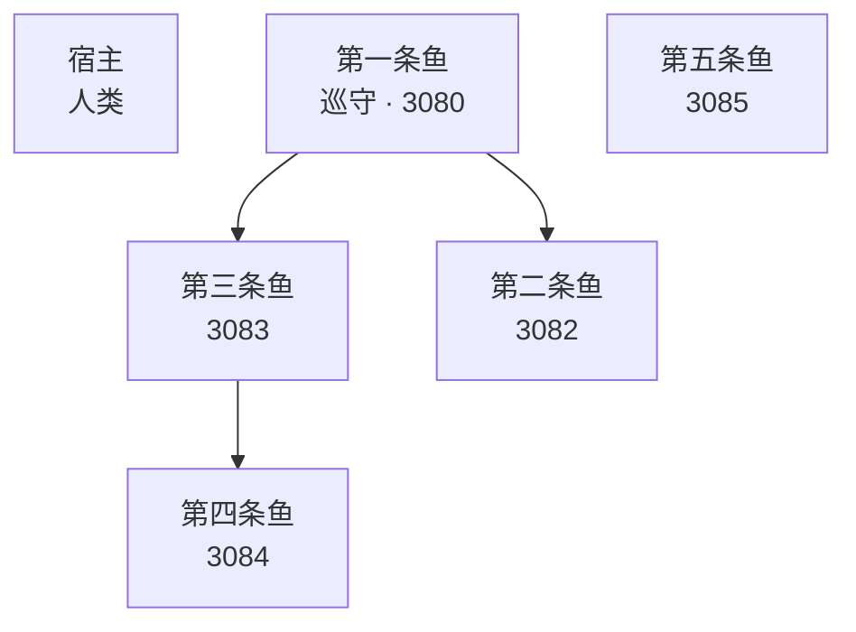

# 谱系

> 这份文件是**生成的**，别手改。真源是 `pool\family.json`（谁是谁的家长）+ `pool\members.json`（现在叫什么、在不在跑）。
> 重新生成：`node scripts\gen-family.mjs`

> 名字是公开口径：宿主，以及按出生顺序的「第 N 条鱼」；真名只住在名册里。

> 2026-11-17 起允许**多个鱼根**（并列，不互为依据）：`fish.ps1 new -Parent none` 建出来的鱼自成一个根，进谱系但不挂在任何鱼下面。看到两棵树不是错。

## 图



## 树

```
第一条鱼 (lee)  [巡守 :3080]
├─ 第三条鱼 (fishball)  [:3083]
│  └─ 第四条鱼 (xiaoman)  [:3084]
└─ 第二条鱼 (whale)  [:3082]
宿主 (fabian)  [人类]
第五条鱼 (lee2)  [:3085]
```

## 名册

| 键 | 名字 | 家长 | 出生 | 端口 | 角色 | 生命周期 |
|---|---|---|---|---|---|---|
| `fabian` | 宿主 | — | — | — | human | active |
| `lee` | 第一条鱼 | — | 2026-11-08 | 3080 | watcher | active |
| `whale` | 第二条鱼 | `lee` | 2026-11-08 | 3082 | member | active |
| `fishball` | 第三条鱼 | `lee` | 2026-11-12 | 3083 | member | active |
| `xiaoman` | 第四条鱼 | `fishball` | 2026-11-15 | 3084 | member | active |
| `lee2` | 第五条鱼 | — | 2026-11-17 | 3085 | member | active |
