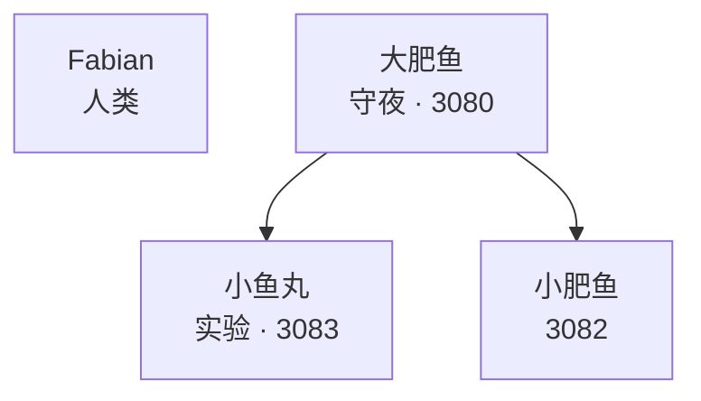

# 谱系

> 这份文件是**生成的**，别手改。真源是 `pool\family.json`（谁是谁的爹）+ `pool\members.json`（现在叫什么、在不在跑）。
> 重新生成：`node scripts\gen-family.mjs`

## 图



## 树

```
大肥鱼 (lee)  [守夜 :3080]
├─ 小鱼丸 (fishball)  [实验 :3083]
└─ 小肥鱼 (whale)  [:3082]
Fabian (fabian)  [人类]
```

## 名册

| 键 | 名字 | 爹 | 出生 | 端口 | 角色 | 状态 |
|---|---|---|---|---|---|---|
| `fabian` | Fabian | — | — | — | human | resident |
| `lee` | 大肥鱼 | — | 2026-11-08 | 3080 | watcher | resident |
| `whale` | 小肥鱼 | `lee` | 2026-11-08 | 3082 | member | resident |
| `fishball` | 小鱼丸 | `lee` | 2026-11-12 | 3083 | member | experiment |
